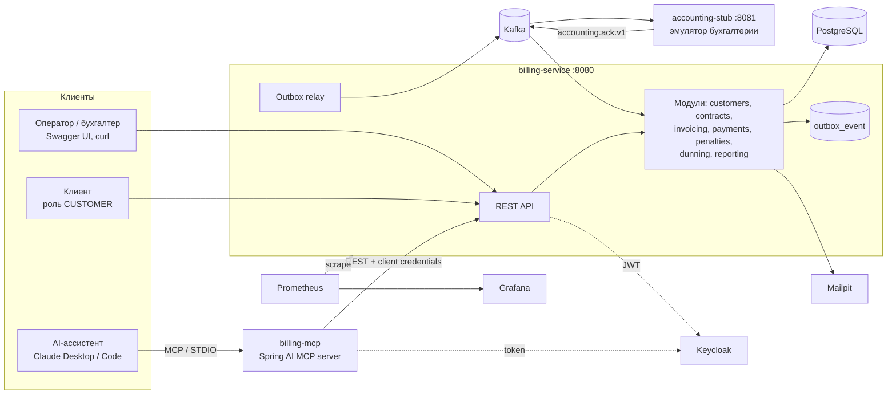

# Pet-проект «billing-hub»: план разработки

Версия плана 1.0 от 29.10.2026. План разработки; текущий статус этапов — в README. Правила для Claude Code — в `CLAUDE.md` в корне. Чек-лист первого дня — в разделе 12.

---

## 0. Цели проекта

1. **Быть законченным:** запускается одной командой, покрыт тестами, есть CI, README и ADR. Недоделанный «фреймворк для всего» хуже маленького законченного проекта.
2. **Быть публичным и чистым.** Только своё: собственные названия, правила и код. Все данные синтетические.

---

## 1. Правила проекта: что нельзя

1. **Никакого чужого кода, SQL, шаблонов, названий, справочников и данных.** Домен — общий биллинг B2B-подписок. Это стандартная бухгалтерская предметная область, а не копия чужой системы.
2. **Только синтетические данные:** генератор на Datafaker. Реальных ИНН, телефонов и e-mail нет.
3. **Никаких секретов в репозитории.** Только `.env.example` и dev-пароли Keycloak с пометкой «только для локального запуска».
4. **Ключевые алгоритмы пишу сам:** нарезка тарифов, FIFO-разноска, пени, outbox. ИИ — для каркаса, тестов, ревью и документации.
5. **Честный README:** что сделано, что нет, как использовался ИИ.

---

## 2. Предметная область: биллинг B2B-подписок

**Сюжет.** Компания сдаёт клиентам-организациям оборудование и сервисы по подписке. У клиента договор. В договоре позиции — тарифный план и количество — со своими датами действия. Цены планов меняются со временем.

Каждый месяц система:
- выставляет счета пропорционально дням действия и ценам;
- принимает платежи из банковской выписки и через API;
- разносит их по счетам по правилу FIFO;
- начисляет пени за просрочку;
- рассылает напоминания должникам;
- отправляет события во внешнюю бухгалтерию через Kafka;
- даёт AI-ассистенту безопасный read-only доступ к данным через MCP.

### 2.1. Глоссарий

- **Customer** — клиент-организация или ИП.
- **Contract** — договор клиента.
- **Plan** — тарифный план.
- **PlanPrice** — цена плана за месяц, действует с даты по дату.
- **ContractItem** — позиция договора: план × количество, со своими датами действия.
- **BillingPeriod** — расчётный месяц, открыт или закрыт.
- **BillingRun** — запуск выставления счетов за период.
- **Invoice / InvoiceLine** — счёт и его строки.
- **Payment** — входящий платёж.
- **PaymentAllocation** — разноска платежа на счёт.
- **Credit** — нераспределённый остаток платежей клиента (переплата).
- **PenaltyRate / PenaltyAccrual** — ставка пени и начисление пени за день.
- **DunningCampaign / DunningMessage** — кампания напоминаний и одно письмо в ней.
- **OutboxEvent** — событие для Kafka, записанное в той же транзакции, что и изменение данных.

### 2.2. Бизнес-правила

Каждое правило должно быть покрыто тестом. Номер правила указывать в названии теста или в `@DisplayName`.

| № | Правило |
|---|---|
| BR-01 | Деньги — только `BigDecimal`, в БД `numeric(19,2)`. Округление до копеек `HALF_UP` на уровне строки счёта. Сумма счёта — это сумма строк, без отдельного округления итога. Отдельный тест: значение с 3+ знаками не роняет выгрузку (`setScale` всегда с `RoundingMode`) |
| BR-02 | Пропорция: строка = цена за месяц × количество × дни действия позиции в периоде / дни в месяце |
| BR-03 | Если цена плана или позиция договора меняется внутри месяца, месяц режется на отрезки, и на каждый отрезок — отдельная строка счёта с датами |
| BR-04 | Выставление идемпотентно: один обычный счёт на договор и период (уникальный индекс `(contract_id, period, kind)` для `kind = REGULAR`). Повторный запуск пропускает договоры, по которым счёт уже есть |
| BR-05 | Закрытый период: нельзя создать, изменить или отменить счёт с периодом ≤ закрытого. Исправления — корректировочным счётом (`kind = CORRECTION`, сумма может быть отрицательной) в открытом периоде |
| BR-06 | Счёт: `DRAFT → ISSUED → PARTIALLY_PAID → PAID`; `ISSUED → CANCELLED` — только если по нему нет разносок и период открыт |
| BR-07 | FIFO-разноска: платёж гасит неоплаченные счета клиента по возрастанию `due_date`, затем по номеру. Остаток — в переплату (credit) |
| BR-08 | При выставлении нового счёта переплата клиента автоматически гасит его |
| BR-09 | Платёж идемпотентен: `external_id` (из банка) уникален. `POST /payments` требует заголовок `Idempotency-Key`. Тот же ключ с тем же телом — тот же ответ; с другим телом — 422 |
| BR-10 | Разноска по одному клиенту строго последовательна: блокировка строки клиента `SELECT … FOR UPDATE`, у счёта — `@Version`. Есть тест: 2 потока × N платежей не дают переплаты или двойной оплаты |
| BR-11 | Отмена разноски помечает её `reversed_at`, сумма возвращается в переплату. Физического удаления нет |
| BR-12 | Пени: каждый день по каждому просроченному счёту (`due_date < дата`, остаток > 0) начисляется остаток × дневная ставка, действующая на дату. Уникальность `(invoice_id, accrual_date)`. Задание идемпотентно и догоняет пропущенные дни |
| BR-13 | Объяснение пеней: разбивка по отрезкам с постоянной базой и ставкой — с, по, дней, база, ставка, сумма. Сумма отрезков = сумме начислений |
| BR-14 | Кампания напоминаний отбирает клиентов с просрочкой ≥ N дней и долгом ≥ X, без флага `dunning_opt_out` |
| BR-15 | Предпросмотр кампании (список и Excel) доступен до старта. Старт необратим. Пауза и остановка срабатывают после текущего пакета. Ошибка одного письма не останавливает кампанию: письмо получает статус `FAILED` с причиной |
| BR-16 | События `InvoiceIssued`, `InvoiceCancelled`, `PaymentAllocated` пишутся в outbox в той же транзакции. Доставка at-least-once, консьюмеры идемпотентны |
| BR-17 | Доступ по ролям: `OPERATOR` — всё; `ACCOUNTANT` — чтение, платежи, периоды; `CUSTOMER` — только свои данные (claim `customer_id` в токене). На чужой ресурс — 404, а не 403, чтобы нельзя было перебором узнать, что ресурс существует |
| BR-18 | Выгрузка реестра счетов в Excel потоковая (SXSSF) и не падает по памяти на 200 тыс. строк |

---

## 3. Стек и версии

Версии сверены 29.10.2026. При старте взять последние патчи на [start.spring.io](https://start.spring.io) и в Maven Central.

| Что | Выбор | Почему |
|---|---|---|
| Java | **25 (LTS)** через Gradle toolchain | Spring Boot 4 требует Java 17+ и рекомендует последний LTS. Запасной вариант — 21, если какая-то библиотека отстаёт |
| Spring Boot | **4.1.x** (вышел 10.06.2026) | Актуальная ветка: Spring Framework 7, Jakarta EE 11, Jackson 3 |
| Сборка | Gradle 9.x, Kotlin DSL, version catalog `gradle/libs.versions.toml` | Gradle уже знаком; Kotlin DSL и каталог версий — современный стандарт |
| Web | `spring-boot-starter-webmvc` | В Boot 4 он заменил `spring-boot-starter-web` |
| JSON | Jackson 3 (`tools.jackson`) | По умолчанию в Boot 4. Аннотации остаются в `com.fasterxml.jackson.annotation` |
| БД | PostgreSQL 17 | Exclusion constraints, `SKIP LOCKED`, jsonb |
| ORM | Spring Data JPA, Hibernate ORM 7 (из BOM Boot 4) | Ключевое слово рынка |
| Миграции | **Liquibase** (`spring-boot-starter-liquibase`) | Все изменения схемы — changeset-ами |
| Kafka | `spring-boot-starter-kafka` (Spring for Apache Kafka 4), Apache Kafka в режиме KRaft | Полный цикл: продюсер, консьюмер, ретраи, DLT |
| Безопасность | Spring Security, OAuth2 Resource Server, Keycloak 26.x в Docker | JWT, роли, проверка владельца |
| API-документация | springdoc-openapi **3.x** (`springdoc-openapi-starter-webmvc-ui`) | Ветка 3.x — для Boot 4 |
| Маппинг | MapStruct | Ключевое слово рынка |
| Excel | Apache POI, `SXSSFWorkbook` | Потоковая запись |
| Планировщик | `@Scheduled` + ShedLock (JDBC) | Задания не дублируются при нескольких экземплярах. Запасной вариант — `pg_try_advisory_lock` |
| Тесты | JUnit 5, AssertJ, Mockito, Testcontainers **2.x**, Awaitility, ArchUnit | Testcontainers 2: артефакты `testcontainers-postgresql` и `testcontainers-kafka`, пакеты `org.testcontainers.postgresql` и т. п., JUnit 4 убран |
| Тест-стартеры | `spring-boot-starter-<технология>-test` | Новая схема Boot 4, например `spring-boot-starter-data-jpa-test` |
| Наблюдаемость | Actuator, Micrometer, Prometheus, Grafana; структурные логи; опционально — OpenTelemetry и Tempo | |
| ИИ | Spring AI **2.0.x** (GA 12.06.2026, рассчитан на Boot 4.0/4.1), `spring-ai-starter-mcp-server` (STDIO) и `-webmvc` (Streamable HTTP) | MCP-сервер на аннотациях `@McpTool` |
| Тестовые данные | Datafaker | Синтетика |
| Нагрузка | k6 | Простые JS-сценарии |
| CI | GitHub Actions, Dependabot, GHCR | |
| Образы | `./gradlew bootBuildImage` (Buildpacks); Dockerfile с layered jar — как учебный вариант | |
| Локальный запуск | `compose.yaml` + `spring-boot-docker-compose` | Сервисы поднимаются автоматически при `bootRun` |

**Lombok не используем:** DTO и события — records, сущности — обычный Java-код. Это показывает современную Java. Lombok можно добавить позже, если захочется.

### Известные ловушки Boot 4

- **Стартеры переименованы:** `spring-boot-starter-web` → `-webmvc`, AOP → `spring-boot-starter-aspectj`.
- **Тестовые стартеры по технологиям:** `@WithMockUser` требует `spring-boot-starter-security-test`.
- **Jackson 3.** Свою настройку JSON делать через бин `JsonMapper`, а не `ObjectMapper`; `@JsonComponent` → `@JacksonComponent`.
- **Совместимость сторонних библиотек.** Перед добавлением проверять поддержку Boot 4 или Jackson 3: springdoc — только 3.x; testcontainers-keycloak, ShedLock — по их release notes.
- **MCP поверх HTTP** открывает неаутентифицированный `POST /mcp`. Без Spring Security наружу не выставлять.

---

## 4. Архитектура

### 4.1. Компоненты



### 4.2. Стиль

- **Модульный монолит + два спутника.** Внутри `billing-service` — пакеты по фичам, а не по слоям. Модуль зовёт другой модуль только через его публичный `*Api`-интерфейс или событие. Границы проверяет тест ArchUnit; Spring Modulith можно попробовать позже, если ветка для Boot 4 стабильна.
- **Внутри модуля:**
  - `api` — публичный интерфейс и DTO-records;
  - `web` — контроллеры;
  - `domain` — сущности и чистая логика без Spring;
  - `app` — сервисы-оркестраторы с транзакциями;
  - `infra` — репозитории, Kafka, Excel.
- **Чистая доменная логика** (нарезка, FIFO, пени) — отдельные классы без Spring. Тестируется unit-тестами за миллисекунды.

### 4.3. Целевая структура репозитория

```text
billing-hub/
├── README.md                      # EN; в конце — «Кратко на русском»
├── CLAUDE.md                      # правила для Claude Code (приложение A)
├── compose.yaml                   # postgres, kafka, kafka-ui, keycloak, mailpit, prometheus, grafana
├── .env.example
├── settings.gradle.kts            # include("billing-service", "accounting-stub", "billing-mcp")
├── build.gradle.kts               # общие настройки, jacoco, toolchain
├── gradle/libs.versions.toml
├── .github/
│   ├── workflows/ci.yml
│   └── dependabot.yml
├── docs/
│   ├── PLAN.md                    # этот файл
│   ├── adr/                       # 0001-modular-monolith.md, 0002-outbox.md, …
│   ├── api-examples.http          # запросы для IntelliJ HTTP Client
│   ├── perf.md                    # замеры до/после, EXPLAIN ANALYZE
│   └── domain.md                  # глоссарий и бизнес-правила
├── infra/
│   ├── keycloak/realm-billing.json
│   ├── prometheus/prometheus.yml
│   └── grafana/{provisioning,dashboards}/
├── load/k6/{invoices-read.js,payments-write.js}
├── billing-service/
│   └── src/
│       ├── main/java/io/github/<login>/billing/
│       │   ├── BillingApplication.java
│       │   ├── shared/            # Money, Period, ошибки, ProblemDetail, security
│       │   ├── customers/{api,web,domain,app,infra}
│       │   ├── contracts/…        # договоры, позиции, планы, цены
│       │   ├── invoicing/…        # периоды, выставление счетов, счета
│       │   ├── payments/…         # платежи, разноска, импорт CSV
│       │   ├── penalties/…
│       │   ├── dunning/…
│       │   ├── reporting/…        # выгрузки Excel, акт сверки
│       │   └── integration/…      # outbox, relay, приём ack
│       ├── main/resources/
│       │   ├── application.yaml
│       │   └── db/changelog/{db.changelog-master.yaml, changes/*.sql}
│       └── test/java/…            # unit, slice, integration, arch
├── accounting-stub/               # отдельное Spring Boot приложение
└── billing-mcp/                   # Spring AI MCP server
```

Пакет `io.github.<login>` — по логину GitHub.

---

## 5. Модель данных

Все таблицы, кроме outbox, получают `id uuid` (UUID v7 из Java), `created_at`, `updated_at` и `version bigint` для оптимистичной блокировки. Схему меняют только Liquibase changeset-ы. **Применённый changeset не редактировать никогда, только новый.**

| Таблица | Ключевые колонки | Ограничения и индексы |
|---|---|---|
| `customer` | `type` (ORG/IE), `name`, `tax_id`, `email`, `phone`, `status` (ACTIVE/ARCHIVED), `dunning_opt_out bool` | частичный unique `tax_id where status = 'ACTIVE'` |
| `contract` | `customer_id`, `number`, `signed_on`, `valid_from`, `valid_to`, `status` (DRAFT/ACTIVE/TERMINATED), `payment_term_days` | unique `number`; индекс `customer_id` |
| `plan` | `code`, `name` | unique `code` |
| `plan_price` | `plan_id`, `valid_from`, `valid_to` (null = бессрочно), `monthly_price numeric(19,2)` | **`EXCLUDE USING gist (plan_id WITH =, daterange(valid_from, valid_to, '[)') WITH &&)`** — периоды цен не пересекаются (нужно расширение `btree_gist`) |
| `contract_item` | `contract_id`, `plan_id`, `quantity`, `valid_from`, `valid_to` | индекс `contract_id` |
| `billing_period` | `period` (date, первое число месяца), `status` (OPEN/CLOSED), `closed_at`, `closed_by` | unique `period` |
| `billing_run` | `period`, `status` (RUNNING/COMPLETED/FAILED), `started_at`, `finished_at`, `contracts_total`, `invoices_created`, `skipped`, `errors` | |
| `invoice` | `number`, `contract_id`, `customer_id`, `period`, `kind` (REGULAR/CORRECTION), `issue_date`, `due_date`, `status`, `total`, `paid`, `accounting_ref` (номер из бухгалтерии) | unique `number`; **частичный unique `(contract_id, period) where kind = 'REGULAR' and status <> 'CANCELLED'`**; индекс `(customer_id, due_date) where status in ('ISSUED','PARTIALLY_PAID')` |
| `invoice_line` | `invoice_id`, `plan_id`, `description`, `quantity`, `unit_price`, `from_date`, `to_date`, `days`, `days_in_month`, `amount` | индекс `invoice_id` |
| `payment` | `external_id`, `customer_id` (null — не опознан), `received_on`, `amount`, `purpose`, `status` (RECEIVED/PARTIALLY_ALLOCATED/ALLOCATED/UNMATCHED), `unallocated` | unique `external_id` |
| `payment_allocation` | `payment_id`, `invoice_id`, `amount`, `allocated_at`, `reversed_at` | индексы `payment_id`, `invoice_id` |
| `penalty_rate` | `valid_from`, `daily_rate numeric(9,6)` | unique `valid_from` |
| `penalty_accrual` | `invoice_id`, `accrual_date`, `base_amount`, `rate`, `amount` | unique `(invoice_id, accrual_date)` |
| `dunning_campaign` | `name`, `status` (DRAFT/RUNNING/PAUSED/STOPPED/COMPLETED), `min_days_overdue`, `min_debt`, `batch_size`, `created_by`, `started_at` | |
| `dunning_message` | `campaign_id`, `customer_id`, `email`, `debt_amount`, `status` (PENDING/SENT/FAILED/SKIPPED), `error`, `sent_at` | unique `(campaign_id, customer_id)` |
| `outbox_event` | `id uuid`, `aggregate_type`, `aggregate_id`, `event_type`, `payload jsonb`, `created_at`, `published_at`, `attempts`, `last_error` | частичный индекс `created_at where published_at is null` |
| `inbox_event` | `event_id` pk, `event_type`, `processed_at` | для идемпотентного приёма `accounting.ack.v1` |
| `idempotency_key` | `key` pk, `request_hash`, `response_status`, `response_body jsonb`, `created_at` | очистка старше 24 ч заданием |
| `shedlock` | по схеме ShedLock | |
| `*_aud`, `revinfo` | Hibernate Envers для `contract`, `contract_item`, `plan_price` | история изменений |

---

## 6. API (REST, `/api/v1`)

Общие правила API:
- **ошибки:** RFC 9457 ProblemDetail (`spring.mvc.problemdetails.enabled=true` + свой `@RestControllerAdvice`), у каждой ошибки свой код в `type`;
- **валидация:** Jakarta Validation;
- **списки:** пагинация `page`, `size`, `sort`; для больших — keyset (`after`);
- **даты:** ISO-8601, деньги — строкой в JSON (`"1234.50"`), чтобы не терять точность;
- **документация:** OpenAPI на `/v3/api-docs`, Swagger UI на `/swagger-ui.html`.

| Метод и путь | Роли | Что делает |
|---|---|---|
| `POST /customers`, `GET /customers?query=&status=`, `GET/PATCH /customers/{id}` | OPERATOR (CUSTOMER — только свой `GET`) | Клиенты |
| `GET /customers/{id}/balance` | все (CUSTOMER — свой) | Долг, переплата, пени |
| `GET /customers/{id}/statement?from=&to=` | все (CUSTOMER — свой) | Выписка: начисления, оплаты, сальдо — аналог акта сверки |
| `POST /plans`, `POST /plans/{id}/prices`, `GET /plans` | OPERATOR | Планы и цены |
| `POST /contracts`, `GET /contracts`, `GET /contracts/{id}`, `POST /contracts/{id}/activate`, `POST /contracts/{id}/terminate` | OPERATOR | Договоры |
| `POST /contracts/{id}/items`, `PATCH /contracts/{id}/items/{itemId}` | OPERATOR | Позиции договора |
| `GET /billing-periods`, `POST /billing-periods/{yyyy-MM}/close` | ACCOUNTANT, OPERATOR | Закрытие периода |
| `POST /billing-runs` `{period}` → 202 + `runId`; `GET /billing-runs/{id}` | OPERATOR | Выставление счетов фоновой задачей |
| `GET /invoices?customerId=&status=&period=&overdue=`, `GET /invoices/{id}` | все (CUSTOMER — свои) | Счета |
| `POST /invoices/{id}/cancel`, `POST /invoices/corrections` | OPERATOR | Отмена и корректировка |
| `GET /invoices/export.xlsx?…` | ACCOUNTANT, OPERATOR | Потоковая выгрузка реестра |
| `POST /payments` (заголовок `Idempotency-Key`) | ACCOUNTANT | Платёж через API |
| `POST /payments/import` (multipart CSV) | ACCOUNTANT | Импорт выписки: отчёт «принято / дубли / не опознано» |
| `GET /payments?…`, `POST /payments/{id}/allocate` `{invoiceId, amount}`, `POST /allocations/{id}/reverse` | ACCOUNTANT | Ручная разноска и отмена |
| `GET /invoices/{id}/penalties`, `GET /invoices/{id}/penalties/explain` | все (CUSTOMER — свои) | Пени и объяснение расчёта |
| `POST /dunning/campaigns`, `GET /dunning/campaigns/{id}/preview`, `GET …/preview.xlsx` | OPERATOR | Создание и предпросмотр |
| `POST /dunning/campaigns/{id}/start | pause | resume | stop`, `GET …/messages` | OPERATOR | Жизненный цикл кампании |

Примеры запросов — в `docs/api-examples.http`.

---

## 7. Интеграция через Kafka

### 7.1. Топики

| Топик | Ключ | Кто пишет → кто читает | События |
|---|---|---|---|
| `billing.invoice.v1` | `customerId` | billing → accounting-stub | `InvoiceIssued`, `InvoiceCancelled` |
| `billing.payment.v1` | `customerId` | billing → accounting-stub | `PaymentAllocated`, `AllocationReversed` |
| `accounting.ack.v1` | `invoiceId` | accounting-stub → billing | `InvoiceRegistered` (`accountingRef`) |
| `*.DLT` | | | Сообщения, которые не удалось обработать после ретраев |

Ключ — `customerId`, чтобы события одного клиента шли по порядку в одной партиции.

### 7.2. Формат события (JSON)

```json
{
  "eventId": "0192f1c4-…",
  "eventType": "InvoiceIssued",
  "eventVersion": 1,
  "occurredAt": "2026-11-01T03:00:12Z",
  "aggregateId": "invoice-uuid",
  "payload": { "number": "INV-2026-11-000123", "customerId": "…", "period": "2026-11", "total": "15400.00", "dueDate": "2026-11-15" }
}
```

### 7.3. Надёжность

- **Transactional outbox.** Сервис в одной транзакции меняет данные и пишет `outbox_event`.
- **Relay.** Каждые 500 мс задача выбирает пачку событий:
  ```sql
  SELECT … FROM outbox_event WHERE published_at IS NULL ORDER BY created_at LIMIT 100 FOR UPDATE SKIP LOCKED
  ```
  Затем отправляет их через `KafkaTemplate` с ожиданием подтверждения и проставляет `published_at`. Ошибка — `attempts + 1`, `last_error`.
- **Почему не «отправить в Kafka прямо из сервиса»** — тема ADR 0002: без outbox теряются события при откате или падении между commit и send.
- **Консьюмер.** `DefaultErrorHandler` с `ExponentialBackOffWithMaxRetries` (3 попытки) и `DeadLetterPublishingRecoverer`. Ошибки валидации не повторяются.
- **Идемпотентность приёма:** `inbox_event(event_id)` — повтор того же события ничего не меняет.
- **accounting-stub** держит свою таблицу обработанных событий. Настройка `accounting.stub.failure-rate=0.2` для демонстрации ретраев и DLT.
- **Метрика `outbox.lag.seconds`** — возраст самого старого неотправленного события.

---

## 8. MCP-сервер (`billing-mcp`)

Цель — безопасный read-only доступ AI-ассистента к данным биллинга. Сервер ходит в REST API `billing-service` с токеном client credentials (клиент Keycloak `billing-mcp`, роль `READONLY`) и не обращается к БД напрямую.

| Инструмент (`@McpTool`) | Параметры | Что возвращает |
|---|---|---|
| `find_customer` | `query` (название или ИНН) | До 10 клиентов: id, название, статус |
| `get_customer_balance` | `customerId` | Долг, переплата, пени, самый старый просроченный счёт |
| `list_overdue_invoices` | `customerId?`, `minDaysOverdue?` | Просроченные счета с днями просрочки |
| `explain_penalty` | `invoiceId` | Разбивка пеней по отрезкам (BR-13) понятным текстом |
| `get_customer_statement` | `customerId`, `from`, `to` | Выписка с сальдо |
| `get_dunning_campaign_status` | `campaignId` | Статус и счётчики писем |

Как настроить:
- **Транспорт по умолчанию — STDIO:** `spring-ai-starter-mcp-server`, `spring.ai.mcp.server.stdio=true`. В STDIO-режиме обязательно отключить баннер и вывод логов в консоль (`spring.main.banner-mode=off`, логи — только в файл), иначе они ломают протокол.
- **Опционально — Streamable HTTP:** `spring-ai-starter-mcp-server-webmvc`, `spring.ai.mcp.server.protocol=STREAMABLE`, только за Spring Security.
- **Подключение к Claude Code:** `claude mcp add billing-hub -- java -jar billing-mcp/build/libs/billing-mcp.jar`. Для Claude Desktop — та же команда в `claude_desktop_config.json`.
- **Демо-сценарии для README:**
  - «Почему у клиента Acme такие пени за октябрь?»
  - «Кто из клиентов должен больше 50 000 и не получал напоминаний?»
  - «Сверь выписку клиента за квартал».
- **Тесты:** каждый инструмент проверяется с замоканным `RestClient` (MockRestServiceServer). Плюс один e2e-тест, который поднимает `billing-service` в Testcontainers.

---

## 9. Тестирование

| Уровень | Чем | Что проверяет | Пример |
|---|---|---|---|
| Unit | JUnit 5, AssertJ, `@ParameterizedTest` | Чистая логика: нарезка, пропорции, FIFO, пени, округление | `ProrationCalculatorTest`: 20+ кейсов — 28/29/30/31 день, смена цены 15-го, позиция с 31-го |
| Unit с моками | Mockito | Оркестрация в `app`-сервисах | `BillingRunServiceTest` |
| Slice JPA | `@DataJpaTest` + Testcontainers PostgreSQL (`@ServiceConnection`) | Запросы, ограничения БД, блокировки | Пересечение цен падает на exclusion constraint |
| Slice Web | `@WebMvcTest` + `jwt()` из spring-security-test | Контроллеры, валидация, ProblemDetail, роли | CUSTOMER получает 404 на чужой счёт |
| Integration | `@SpringBootTest` + Testcontainers (PostgreSQL, Kafka), Awaitility | Сквозные сценарии | Выставили счёт → событие в Kafka → ack от заглушки → `accounting_ref` у счёта |
| Конкурентность | `ExecutorService` / virtual threads + `CountDownLatch` | BR-10 | 2 × 50 платежей одного клиента: сумма разносок = сумма платежей |
| Защита от N+1 | Hibernate statistics или datasource-proxy | Число SQL-запросов | `GET /invoices?size=50` — не больше 3 запросов |
| Архитектура | ArchUnit | Границы модулей, `domain` без Spring | Модули не импортируют чужие `infra` и `domain` |
| Нагрузка | k6 | Время ответа, пропускная способность | p95 `GET /invoices` < 200 мс на 200 тыс. счетов; результаты — в `docs/perf.md` |

Как организовать:
- **Контейнеры поднимаются один раз на все тесты:** общий `@TestConfiguration` с `@Bean @ServiceConnection` или `@ImportTestcontainers`. Это быстрее, чем по контейнеру на класс.
- **Локальный запуск с тестовыми контейнерами:** `TestBillingApplication` + `./gradlew :billing-service:bootTestRun`.
- **Покрытие:** JaCoCo, порог 80 % на пакетах `domain` и `app`, CI падает ниже порога. PIT (мутационное тестирование) — опционально в M7.

---

## 10. Наблюдаемость и эксплуатация

- **Actuator:** `health` (liveness и readiness), `info` (git и build), `metrics`, `prometheus`. Наружу — только `health`, `info`, `prometheus`.
- **Свои метрики** (Micrometer):
  - `billing.run.duration` (timer);
  - `billing.invoices.created` (counter);
  - `payments.unallocated.amount` (gauge);
  - `outbox.lag.seconds` (gauge);
  - `dunning.messages{status}` (counter);
  - `penalties.accrued.amount` (counter).
- **Логи:** структурные, `logging.structured.format.console=ecs`, плюс `traceId` и `runId`/`campaignId` в MDC.
- **Дашборд Grafana** провиженится из `infra/grafana/dashboards/billing.json`: RPS и латентность API, outbox lag, ошибки консьюмера, длительность выставления счетов, JVM (heap, GC, потоки).
- **Трассировка (опционально):** Micrometer Tracing + OpenTelemetry → Grafana Tempo. Сквозной trace «HTTP → outbox → Kafka → консьюмер».
- **Virtual threads:** `spring.threads.virtual.enabled=true`. В `docs/perf.md` сравнить замеры k6 с ними и без них.

---

## 11. Этапы

Оценки — при 8–10 часах в неделю. Общий объём — 120–140 ч, около 12–14 недель. **MVP, который уже не стыдно показать, — M0–M5 (~70 ч).**

### M0. Каркас (6–8 ч)

1. Репозиторий на GitHub (public, лицензия Apache-2.0), README-заглушка, `CLAUDE.md`.
2. Gradle multi-project, version catalog, toolchain 25, JaCoCo, Spotless (palantir-java-format) или другой форматтер.
3. `billing-service`:
   - стартеры webmvc, data-jpa, liquibase, validation, actuator;
   - драйвер PostgreSQL;
   - `spring-boot-docker-compose`.
4. `compose.yaml`: на этом этапе только postgres.
5. Liquibase master changelog, первый changeset (`btree_gist`, таблица `customer`).
6. `GET /actuator/health` = UP. Первый интеграционный тест с Testcontainers.
7. CI в `.github/workflows/ci.yml`:
   - `actions/checkout`;
   - `actions/setup-java` (temurin 25);
   - `gradle/actions/setup-gradle`;
   - `./gradlew check`;
   - отчёт JaCoCo как артефакт.
8. Dependabot для gradle и github-actions.

**Готово, когда:** `git clone && docker compose up -d && ./gradlew bootRun` работает, CI зелёный.

### M1. Клиенты, договоры, планы (10–12 ч)

1. Сущности `Customer`, `Contract`, `ContractItem`, `Plan`, `PlanPrice` и changeset-ы.
2. Exclusion constraint на `plan_price` и тест, что пересечение отклоняется.
3. REST CRUD, MapStruct, валидация, ProblemDetail, пагинация, springdoc.
4. Envers для истории договоров и цен.
5. `docs/api-examples.http`.
6. ADR 0001 «Модульный монолит + пакеты по фичам».

**Готово, когда:** Swagger UI открывается, CRUD покрыт `@WebMvcTest` и `@DataJpaTest`.

### M2. Выставление счетов и закрытие периода (12–14 ч)

1. `ProrationCalculator` — чистая логика BR-02, BR-03 с параметризованными тестами. Сначала тесты.
2. `BillingRunService`: пачки по 500 договоров, каждая в своей транзакции, идемпотентность BR-04, статистика в `billing_run`. `POST /billing-runs` → 202.
3. `BillingPeriod`: закрытие, запреты BR-05, корректировочный счёт.
4. Статусы счёта BR-06.
5. Потоковая выгрузка `/invoices/export.xlsx` (SXSSF), BR-18.
6. Генератор демо-данных (профиль `demo`, Datafaker): 10 тыс. клиентов, 15 тыс. договоров, 12 месяцев счетов. Вставка JDBC batch, `hibernate.jdbc.batch_size`.
7. Первые замеры в `docs/perf.md`: время выставления по 15 тыс. договорам, `EXPLAIN ANALYZE` запроса просроченных счетов, индексы.

**Готово, когда:** повторный запуск не создаёт дублей, закрытый период защищён тестами, есть замеры.

### M3. Платежи и разноска (12–14 ч)

1. `Payment`, `PaymentAllocation`, `AllocationService` с FIFO (BR-07), переплатой (BR-08) и отменой (BR-11).
2. `POST /payments` с `Idempotency-Key` (BR-09): фильтр или аспект и таблица `idempotency_key`.
3. Импорт CSV-выписки: отчёт «принято / дубль / не опознан по ИНН».
4. Блокировки BR-10 и тест конкурентности.
5. `GET /customers/{id}/balance` и `/statement`.

**Готово, когда:** тест конкурентности стабильно зелёный 20 прогонов подряд (`@RepeatedTest`).

### M4. Пени (8–10 ч)

1. `PenaltyCalculator` (чистая логика) и `PenaltyAccrualJob` (`@Scheduled` + ShedLock), догон пропущенных дней (BR-12).
2. `penalty_rate` с историей ставок.
3. `/penalties/explain` (BR-13): сумма отрезков = сумме начислений, это проверяет тест.
4. Выгрузка пеней в Excel, тест на округление (BR-01).

**Готово, когда:** пени за 90 дней просрочки со сменой ставки совпадают с ручным расчётом в тесте.

### M5. Kafka, outbox и accounting-stub (12–14 ч)

1. В `compose.yaml` — Kafka (KRaft) и kafka-ui.
2. `outbox_event`, запись событий в доменных сервисах, relay с `FOR UPDATE SKIP LOCKED`.
3. Модуль `accounting-stub`: свой Spring Boot, консьюмер, своя БД (схема в том же Postgres), ack в `accounting.ack.v1`, `failure-rate`.
4. Консьюмер ack в billing: `inbox_event`, проставление `accounting_ref`.
5. `DefaultErrorHandler`, backoff, DLT. Тест: «отравленное» сообщение уходит в DLT.
6. Интеграционные тесты на Testcontainers Kafka (`org.testcontainers.kafka.KafkaContainer`, образ `apache/kafka`).
7. ADR 0002 «Transactional outbox вместо прямой отправки».

**Готово, когда:** при остановке Kafka на минуту ни одно событие не теряется — это сценарий в README. **Здесь заканчивается MVP: обновить README.**

### M6. Безопасность (8–10 ч)

1. В `compose.yaml` — Keycloak (`start-dev --import-realm`), `infra/keycloak/realm-billing.json`:
   - клиенты `billing-api` и `billing-mcp`;
   - роли OPERATOR, ACCOUNTANT, CUSTOMER, READONLY;
   - пользователи `operator`, `accountant`, `customer1` с атрибутом `customer_id` → claim.
2. Resource server с JWT, конвертер `realm_access.roles` → `ROLE_*`, `@PreAuthorize`.
3. Проверка владельца для CUSTOMER в сервисном слое (BR-17), ответ 404.
4. Тесты ролей через `jwt()`, один e2e с настоящим Keycloak в Testcontainers — если библиотека совместима с Testcontainers 2.
5. ADR 0003 «404 вместо 403 для чужих ресурсов».

**Готово, когда:** матрица «роль × эндпоинт» покрыта параметризованным тестом.

### M7. Наблюдаемость и производительность (8–10 ч)

1. Prometheus, Grafana, свои метрики, дашборд в репозитории, структурные логи.
2. Сценарии k6, сравнение с virtual threads и без, поиск N+1 (`@EntityGraph`, fetch join, проекции), тест на число запросов.
3. Индексы по результатам `EXPLAIN ANALYZE`, всё «до → после» — в `docs/perf.md`.
4. Опционально — OpenTelemetry и Tempo.

**Готово, когда:** в `docs/perf.md` минимум 3 измеренных улучшения с цифрами.

### M8. MCP-сервер (8–10 ч)

1. Модуль `billing-mcp`: Spring AI 2.0.x BOM, `spring-ai-starter-mcp-server`, 6 инструментов `@McpTool`.
2. `RestClient` с OAuth2 client credentials (`spring-boot-starter-oauth2-client`).
3. Тесты инструментов, инструкция подключения к Claude Code и Desktop, GIF с демо в README.
4. Опционально — Streamable HTTP за Spring Security.

**Готово, когда:** в Claude Desktop или Code на вопрос «почему такие пени у клиента X» ассистент отвечает по данным проекта.

### M9. Рассылки напоминаний (опционально, 8–10 ч)

1. Кампании BR-14, BR-15: предпросмотр, Excel, старт, пауза, возобновление, остановка.
2. Отправка пакетами через `JavaMailSender` в Mailpit.
3. Тест «одно письмо с ошибкой не останавливает кампанию».

### M10. Шлифовка (4–6 ч)

1. Образы через `bootBuildImage`, публикация в GHCR из CI на `main`.
2. Финальный README:
   - что это, архитектура (Mermaid), как запустить, демо-сценарии;
   - ссылки на ADR и perf;
   - раздел «How AI was used»;
   - что бы сделал дальше.
3. Теги релизов `v0.1.0` (MVP) и `v1.0.0`.

### Дальше, если будет время

- Kubernetes: kind + Helm-чарт, readiness- и liveness-пробы.
- Spring Batch для импорта больших выписок.
- GraphQL для отчётов.
- Тесты с несколькими экземплярами `billing-service` (ShedLock в деле).
- Frontend не нужен: это backend-портфолио, Swagger UI достаточно.

---

## 12. Первый день: чек-лист

Шаги 1–7 выполнены в M0. Шаг 8 (Issues и доска) в репозитории не проверялся.

1. Создать на GitHub публичный репозиторий `billing-hub` с README и лицензией Apache-2.0.
2. На [start.spring.io](https://start.spring.io) создать каркас:
   - **параметры:** Gradle — Kotlin, Java 25, Spring Boot — последний 4.1.x, Group `io.github.<login>`, Artifact `billing-service`, Package name `io.github.<login>.billing`;
   - **зависимости:** Spring Web, Spring Data JPA, PostgreSQL Driver, Liquibase Migration, Validation, Spring Boot Actuator, Docker Compose Support, Testcontainers, Configuration Processor.

   Kafka, Security, OAuth2 Resource Server и Prometheus добавить позже, на своих этапах: так каждый коммит остаётся понятным.
3. Распаковать каркас как подпроект `billing-service/`, в корне сделать `settings.gradle.kts` с `include("billing-service")`. Перенести версии в `gradle/libs.versions.toml`.
4. Положить в корень `CLAUDE.md` (приложение A), `docs/PLAN.md` (этот файл) и `.gitignore` (Gradle, IDEA, `.env`).
5. `compose.yaml` с postgres:17 (пароль только из `.env`), `.env.example`.
6. Первый changeset Liquibase и проверка `./gradlew bootRun` → `/actuator/health`.
7. CI-workflow, push, зелёная галочка.
8. Завести на GitHub Issues по этапам M0–M10 (задачи из раздела 11) и Project-доску «Todo / In progress / Done».

**Как вести работу:**
- одна задача — одна ветка `feat/m1-customers-crud` — один PR в `main` (даже в одиночку);
- в описании PR: что сделано, как проверить, какие решения приняты;
- сообщения коммитов — в стиле Conventional Commits: `feat(payments): FIFO allocation`.

---

## 13. Как использовать Claude Code в этом проекте

ИИ ускоряет рутину, а решения и ключевой код остаются за автором.

- **Сначала план, потом код.** Для каждой задачи первым шагом просить у агента план и тест-кейсы, править их, и только потом давать писать.
- **Ключевые алгоритмы писать самому,** агента использовать как ревьюера: нарезка, FIFO, пени, outbox relay, проверка владельца.
- **Агенту можно отдавать:** каркас CRUD, changeset-ы по готовой схеме, тесты по списку кейсов, конфигурацию compose и CI, README и ADR по согласованным тезисам.
- **После каждой правки агента смотреть дифф.** Агенты иногда трогают лишнее, например удаляют комментарии.
- **В README — раздел «How AI was used»:** что делал ИИ, что делал автор, как проверялось.

---

## 14. Риски и как их снизить

| Риск | Что делать |
|---|---|
| Проект расползается, ничего не закончено | Жёсткий MVP M0–M5; M9 и «дальше» — только после релиза `v0.1.0` |
| Библиотека не поддерживает Boot 4 или Jackson 3 | Перед добавлением смотреть release notes; есть запасные варианты (advisory lock вместо ShedLock, `jwt()` вместо Keycloak в тестах); в крайнем случае — Java 21 |
| Перестройка по ходу | Решения фиксировать в ADR, план обновлять по итогам этапа, а не на ходу |

---

## Приложение A. CLAUDE.md

Стартовая версия `CLAUDE.md` удалена, чтобы не расходиться с текущими правилами. Актуальный файл — `CLAUDE.md` в корне репозитория.

---

## Приложение B. Черновик `compose.yaml`

Теги образов зафиксировать при старте на актуальных стабильных версиях.

```yaml
services:
  postgres:
    image: postgres:17
    environment:
      POSTGRES_DB: billing
      POSTGRES_USER: billing
      POSTGRES_PASSWORD: ${POSTGRES_PASSWORD}
    ports: ["5432:5432"]
  kafka:
    image: apache/kafka:<tag>        # KRaft, без ZooKeeper
    ports: ["9092:9092"]
  kafka-ui:
    image: kafbat/kafka-ui:<tag>
    ports: ["8090:8080"]
    environment:
      KAFKA_CLUSTERS_0_NAME: local
      KAFKA_CLUSTERS_0_BOOTSTRAPSERVERS: kafka:9092
  keycloak:
    image: quay.io/keycloak/keycloak:26.<x>
    command: start-dev --import-realm
    environment:
      KC_BOOTSTRAP_ADMIN_USERNAME: admin
      KC_BOOTSTRAP_ADMIN_PASSWORD: ${KEYCLOAK_ADMIN_PASSWORD}
    volumes: ["./infra/keycloak:/opt/keycloak/data/import"]
    ports: ["8180:8080"]
  mailpit:
    image: axllent/mailpit:<tag>
    ports: ["8025:8025", "1025:1025"]
  prometheus:
    image: prom/prometheus:<tag>
    volumes: ["./infra/prometheus/prometheus.yml:/etc/prometheus/prometheus.yml"]
    ports: ["9090:9090"]
  grafana:
    image: grafana/grafana:<tag>
    volumes: ["./infra/grafana/provisioning:/etc/grafana/provisioning", "./infra/grafana/dashboards:/var/lib/grafana/dashboards"]
    ports: ["3000:3000"]
```

У Kafka в KRaft-режиме для доступа и из контейнеров, и с хоста нужны два listener-а: внутренний `kafka:9092` и внешний `localhost:9094`. Настроить по документации образа `apache/kafka`.

---

## Приложение C. Источники по версиям (проверены 29.10.2026)

- Spring Boot 4.0 Migration Guide — Java 17+, переименованные стартеры, тестовые стартеры, Liquibase- и Kafka-стартеры, Jackson 3: https://github.com/spring-projects/spring-boot/wiki/Spring-Boot-4.0-Migration-Guide
- Версии Spring Boot (4.1 вышел 10.06.2026): https://www.versio.io/de/product-release-end-of-life-eol-broadcom-spring-boot.html
- Spring AI 2.0.0 GA (12.06.2026), совместимость с Boot 4.0/4.1: https://spring.io/blog/2026/06/12/spring-ai-2-0-0-GA-available-now/
- Spring AI MCP Server Boot Starter — артефакты, транспорты, `@McpTool`: https://docs.spring.io/spring-ai/reference/api/mcp/mcp-server-boot-starter-docs.html
- Testcontainers 2.0 — переименование артефактов и пакетов: https://docs.openrewrite.org/recipes/java/testing/testcontainers/testcontainers2dependencies
- Spring Boot 4 и Testcontainers 2.x: https://github.com/spring-projects/spring-boot/issues/48104
- springdoc-openapi — v3 для Spring Boot 4: https://github.com/springdoc/springdoc-openapi
